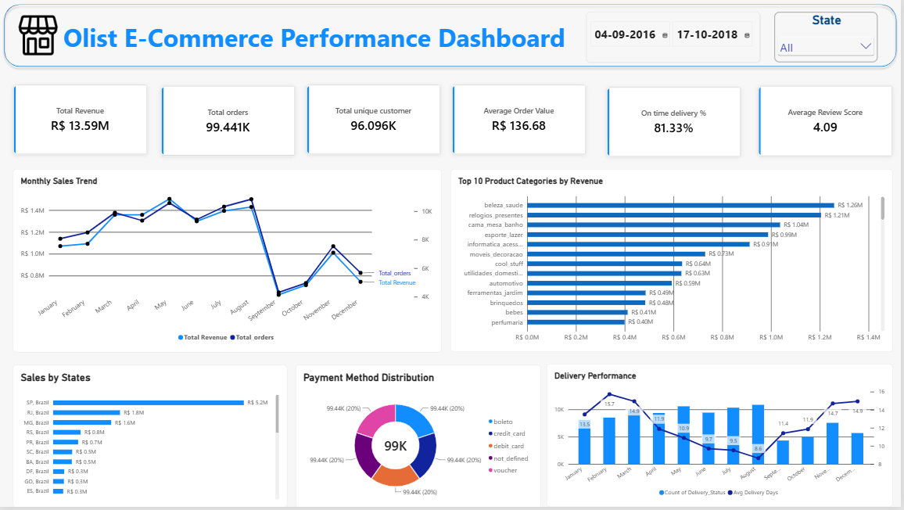
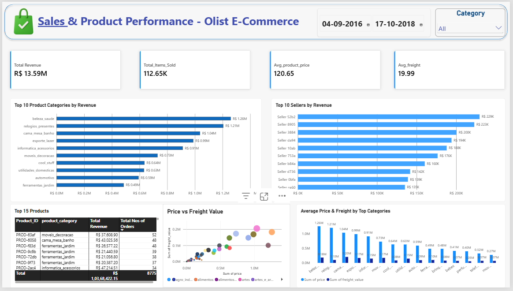
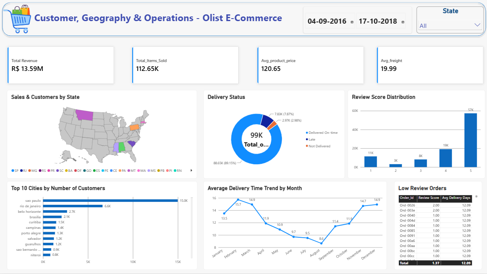

# Olist E-Commerce Performance Analysis

An end-to-end data analytics project exploring Olist e-commerce operations using **MySQL** for data setup and profiling and **Power BI** for interactive reporting.

The project brings together order, customer, product, seller, payment, review, and delivery data to examine sales performance, customer distribution, product-category performance, payment methods, delivery outcomes, and customer review patterns.

## Project Objectives

* Build a relational data structure for the Olist e-commerce dataset.
* Load the source CSV files into MySQL.
* Profile the data and check for missing values, duplicates, and potential inconsistencies.
* Build a Power BI report to monitor key business metrics and explore performance across time, geography, products, sellers, payments, and delivery.
* Practice an end-to-end analytics workflow from data preparation to dashboard reporting.

## Tools & Technologies

* **MySQL** — database creation, CSV import, SQL queries, and data profiling.
* **Microsoft Power BI** — report pages, KPI cards, charts, slicers, and interactive analysis.
* **SQL** — aggregation, joins, conditional checks, date analysis, and duplicate checks.

## Repository & Project Structure

The project directory structure is organized as follows:

```text
D:\Data_Analyst_Projects\Project_2\
├── images/
│   ├── Dashboard_1.png
│   ├── Dashboard_2.png
│   └── Dashboard_3.png
├── powerbi/
│   └── powerbi.pbix
├── sql/
│   ├── 01_table_create.sql
│   ├── 02_data_import.sql
│   └── 03_data_profiling.sql
└── README.md
```

### SQL Workflow (`D:\Data_Analyst_Projects\Project_2\sql`)

The SQL scripts reside in the `sql` directory:

| File | Purpose |
| --- | --- |
| `sql/01_table_create.sql` | Creates the database and tables for customers, geolocation, order items, payments, reviews, orders, products, sellers, and product-category translations. |
| `sql/02_data_import.sql` | Loads CSV files into MySQL using `LOAD DATA LOCAL INFILE` and checks table row counts. |
| `sql/03_data_profiling.sql` | Checks table sizes, customer uniqueness, review/order relationships, orders without items, missing or zero values, delivery-date issues, payment types, price/freight summaries, category translations, and duplicate geolocation records. |

### Power BI Report (`D:\Data_Analyst_Projects\Project_2\powerbi`)

The interactive report file (`.pbix`) is located in the `powerbi` folder.

## Dashboard Overview

Below are preview screenshots of the interactive Power BI dashboard:

### 1. Executive Overview


High-level performance indicators and trends, including:
* Total Revenue
* Total Orders
* Total Unique Customers
* Average Order Value
* On-time Delivery Percentage
* Average Review Score
* Monthly Sales Trend
* Sales by State
* Payment Method Distribution
* Delivery Status

### 2. Sales & Product Performance


Product and seller analysis, including:
* Top 10 Product Categories by Revenue
* Top 10 Sellers by Revenue
* Average Price and Freight by Product Category
* Price vs. Freight Value
* Total Items Sold
* Average Product Price
* Average Freight
* Product-level summary table

### 3. Customer, Geography & Operations


Geographic and operational breakdown, including:
* Sales and customers by state
* Top 10 cities by customer count
* Review score distribution
* Low-review orders
* Average delivery-time trend by month

## Data Tables

The SQL scripts reference these core datasets:

* `customers`
* `geolocation`
* `order_items`
* `order_payments`
* `order_reviews`
* `orders`
* `products`
* `sellers_dataset`
* `product_category_name_translation`

## How to Run the Project

### 1. Prepare the Data
Obtain the Olist CSV files required by the SQL import script and ensure they are placed in your accessible local directory.

### 2. Run SQL Scripts (`D:\Data_Analyst_Projects\Project_2\sql`)
* Open and execute `01_table_create.sql` in MySQL Workbench to initialize the schema.
* Update local CSV file paths in `02_data_import.sql` and run it to import data.
* Execute `03_data_profiling.sql` to verify data integrity and view quality metrics.

### 3. Open Power BI Dashboard (`D:\Data_Analyst_Projects\Project_2\powerbi`)
* Open the `.pbix` file inside the `powerbi` folder using Microsoft Power BI Desktop.
* Update data source settings if prompted to reconnect to your local MySQL database or datasets, then click **Refresh**.

## Key Business Questions Addressed

* How does revenue change over time?
* Which states and cities contribute most to sales or customer volume?
* Which product categories and sellers generate the most revenue?
* How are orders distributed across payment methods and delivery statuses?
* What are the average order value, product price, and freight value?
* How do delivery times and review scores vary across orders?

### ⭐️ Author & Connect

Created with ❤️ by **Shivanshu Rawat**  
* GitHub: [@shivanshurwt](https://github.com/shivanshurwt)
* LinkedIn: [Shivanshu Rawat](https://www.linkedin.com/in/shivanshurawat)

If you find this project helpful or inspiring for your own data portfolio, please give it a star on GitHub!